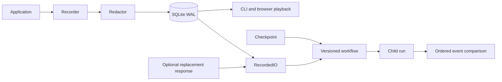

# Architecture and execution contracts

## Durability before throughput

Each event start commits before its callback executes. Completion is a second transaction. A process death leaves a `running` event and run that remain inspectable; it never fabricates a successful outcome. SQLite rolls back uncommitted writes. Connections are short-lived and close explicitly; writers serialize through SQLite with a 15-second busy timeout. This simplifies ownership across threads at a measured cost of about 8.8 ms per tool call on the benchmark host.

There is no recovery daemon. A permanently interrupted run remains marked `running` until an external operator handles it; replay refuses that run. A storage error propagates to the application. The recorder cannot atomically commit an external tool side effect together with its local completion record.

## Ordering and concurrency

Event sequence numbers reflect start order within a recorder and are allocated under a lock. A ContextVar holds the current parent per async context. Child calls point to their parent sequence, even when concurrent calls interleave. Independent recorders have independent context variables and run IDs. Threads do not implicitly inherit the caller's context. Finish all tasks before closing their recorder.

Duration uses a monotonic clock, excludes the event-start and event-completion commits, and includes nested recording overhead for spans. Start time is Unix nanoseconds. The browser waterfall uses wall-clock starts, so clock corrections can distort relative placement; durations remain monotonic. JavaScript cannot represent every nanosecond of Unix timestamps exactly; the display is millisecond precision.

## Checkpoint contract

A workflow supplies a stable name, version, JSON initial state, and a `resume(state, io, recorder)` method. Checkpoints must contain all state required to resume before the next call. A fork copies the nearest preceding checkpoint into a new execution with parent-run lineage. It does not mutate the source or copy the earlier prefix into the child.

RecordedIO consumes responses in order, requiring identical tool names and sanitized arguments. It rejects failed responses, incompatible adapters, missing responses, and leftover responses. A fork substitutes exactly one selected response. Local decision code executes again; later model/tool results come from the original trace. A new branch requiring different calls therefore fails closed rather than inventing results. This intentionally conservative policy is useful for controlled interventions, not unconstrained exploration.

The registered inventory workflow has one checkpoint. Additional workflows can register in process. The stock CLI only loads built-in workflows; plugin discovery and serialized executable code are deliberately absent.

## Comparison

Comparison removes span envelopes and compares remaining events positionally, ignoring timing, origin labels, and generated IDs. It reports changed names, kinds, arguments, results, statuses, and errors. This is an ordered structural diff, not causal attribution. For a fork from a later checkpoint, compare the equivalent suffix when interpreting differences; the CLI currently displays the unmatched prefix as differences. Branch alignment is future work.

## Security boundary

Replay is a cooperative application-level contract. Registered workflow code is trusted. RecordedIO contains no live callback and Recorder rejects direct live calls in offline/fork policies. This does not sandbox arbitrary Python. Prefer separate process/container isolation when running code you do not control.

Redaction snapshots JSON values before any SQLite write, including exceptions. It recognizes configurable exact dictionary keys and literals plus `sk-` and `ghp_` prefixes. It cannot recognize all sensitive prose, encoded credentials, or domain-specific secrets. Supply a custom Redactor for your application. Raw values remain in application memory. Redacted traces cannot replay because redaction is intentionally irreversible.

The web server is local, has no CORS allowance, checks Host to resist DNS rebinding, requires same-origin JSON writes, sets a restrictive CSP, and does not inject trace content as HTML. It is a local development server, not a multi-user deployment architecture.
